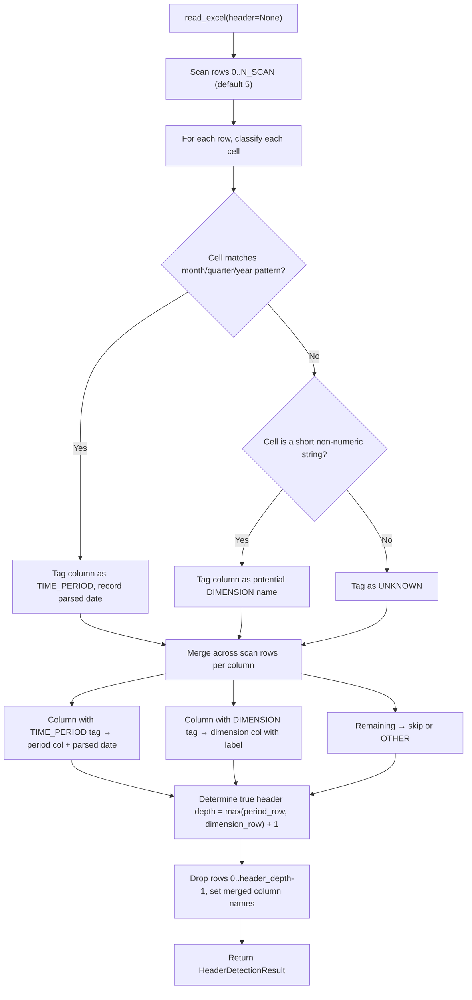
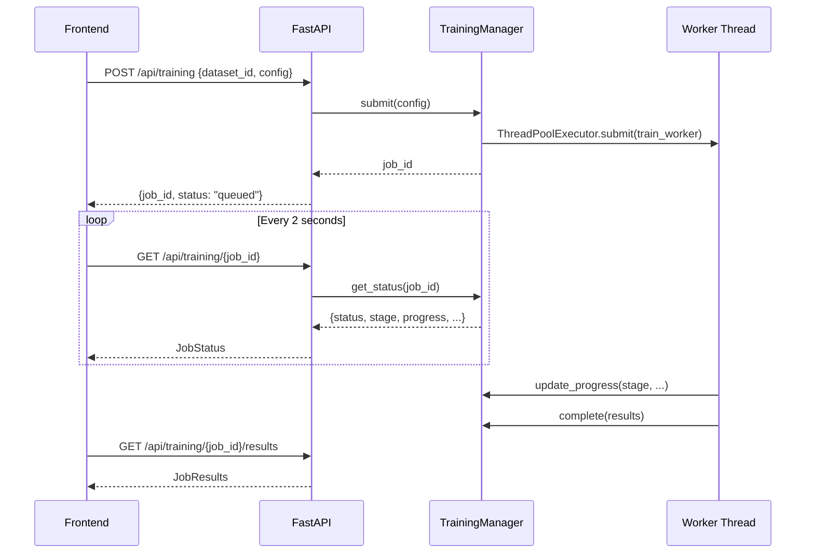
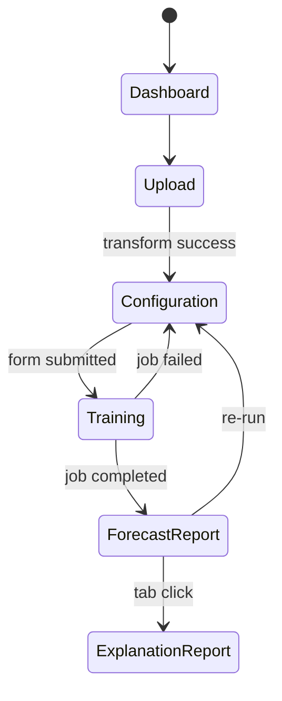

# Implementation Plan: Full-Stack Time-Series Forecasting Application

## Goal Description

Build a complete, working, full-stack time-series forecasting application inspired by SAP Analytics Cloud Smart Predict. The application consists of:

- **Backend:** FastAPI + Python + Darts, structured as a modular application in `Backend/src/backend/`
- **Frontend:** React + TypeScript + Vite, structured as a polished enterprise dashboard in `Frontend/src/`
- **Data:** Excel workbooks with dynamic, multi-row header detection
- **Forecasting:** Multiple candidate Darts models, chronological validation, automatic model selection, future forecasting
- **Reports:** Forecast Report + Explanation Report with real computed results

---

## Codebase Findings

### Repository State
| Location | Status |
|---|---|
| `Backend/` | `uv init` done; venv at `.venv/`; package `backend` installed editable |
| `Backend/src/backend/__init__.py` | Minimal stub — only `main()` print |
| `Backend/notebooks/time_series.ipynb` | Full 33-cell notebook — source of truth |
| `Backend/data/Story.xlsx` | Sample SAC workbook (sheet: `Table_3`) |
| `Frontend/` | Vite + React 19 + TypeScript scaffold — default boilerplate only |
| `Frontend/src/App.tsx` | Default Vite welcome page |

### Installed Backend Packages (key ones)
| Package | Version | Notes |
|---|---|---|
| `darts` | 0.48.1 | Core forecasting library |
| `catboost` | 1.2.10 | Available |
| `lightgbm` | 4.7.0 | Available |
| `xgboost` | 3.4.1 | Available |
| `prophet` | 1.5.0 | Available |
| `statsforecast` | 2.0.1 | Available |
| `plotly` | 7.1.0 | Already installed |
| `openpyxl` | 3.1.5 | Excel reading |
| `pandas` | 3.0.6 | Latest |
| `numpy` | 2.3.5 | Latest |
| `scikit-learn` | 1.9.1 | Available |
| `statsmodels` | 0.15.0 | Available |

**Missing (must add):** `fastapi`, `uvicorn[standard]`, `pydantic`, `python-multipart`, `aiofiles`, `httpx`, `pytest`, `pytest-asyncio`

### Frontend Installed Packages
- `react` 19.3.1 + `react-dom`, TypeScript 6.0, Vite 8.3
- **Missing (must install):** `react-router-dom`, `recharts`, `axios`, `@tanstack/react-query`, `lucide-react` (icons), and a CSS framework (Tailwind CSS or plain CSS modules)

### Notebook Analysis — Key Patterns

**Data loading:**
```python
raw = pd.read_excel(file_path, sheet_name="Table_3")
# First row contains actual dimension names: Business unit, SAC_Legal_Entity, ACCOUNT, Description
mapper = dict(zip(raw.columns[:4], raw.iloc[0].dropna().values))
raw.rename(columns=mapper, inplace=True)
raw.drop(index=0, inplace=True)
raw.fillna(0, inplace=True)  # NOTE: We will NOT auto-fill 0 per requirements
```

**Monthly column detection:**
```python
MONTH_PATTERN = re.compile(r"^(Jan|Feb|...)\\s*\\(\\s*(\\d{4})\\s*\\)$", re.IGNORECASE)
parse_month_column(col)  # Returns pd.Timestamp or None
```

**Dimensions:** First 4 columns after header fix = `["Business unit", "SAC_Legal_Entity", "ACCOUNT", "Description"]` — but must be *detected*, not hardcoded.

**Model families (from Cell 23–24):**
```python
# Baseline
NaiveSeasonal(K=12)
# Statistical
ARIMA(p=2,d=1,q=1), AutoARIMA(season_length=12,...), ExponentialSmoothing(),
AutoETS(season_length=12), AutoCES(season_length=12),
Prophet(yearly_seasonality=True,...),
Theta, AutoTheta  # (present in imports in Cell 23)
# ML
LinearRegressionModel(lags=12, output_chunk_length=12),
RandomForestModel(lags=12, output_chunk_length=12, n_estimators=200,...),
CatBoostModel, LightGBMModel, XGBModel  # optional
```

**Validation split:** `split_before(0.75)` chronological, validation horizon = 12.

**Selection metric:** Lowest finite MAPE from `darts.metrics.mape`.

**Available darts.utils.statistics:** `check_seasonality`, `extract_trend_and_seasonality`, `plot_acf`, `plot_pacf`, `plot_residuals_analysis`, `seasonal_decompose`, `stationarity_tests`, `remove_trend`, `remove_seasonality`.

**Available darts.metrics:** `mape`, `mae`, `rmse`, `r2_score`, `smape`, `mase`.

---

## User Review Required

> [!IMPORTANT]
> **Frontend styling framework**: The project has no CSS framework installed. The plan uses **Tailwind CSS v4** (already compatible with Vite 8), providing the SAP-inspired enterprise look without bloat. If you prefer plain CSS modules or another framework, say so before proceeding.

> [!IMPORTANT]
> **Missing backend dependencies**: `fastapi`, `uvicorn[standard]`, `python-multipart`, `aiofiles`, `pydantic`, `httpx`, `pytest`, `pytest-asyncio` will be added via `uv add`. This modifies `pyproject.toml`. Confirm this is acceptable.

> [!WARNING]
> **`raw.fillna(0)` in notebook**: Cell 10 globally replaces NaN with 0. Per requirements, we will **NOT** do this — we will preserve NaN and expose a missing-data policy to the user. The notebook CSV may contain zeros that are actually missing. The backend will track this.

> [!IMPORTANT]
> **Thread-based training**: Training will run in `concurrent.futures.ThreadPoolExecutor` (not asyncio, since Darts is CPU-bound). This keeps it local-only without Redis/Celery. The limitation is that multiple simultaneous users would block each other — acceptable for a local app.

> [!IMPORTANT]
> **React State Management**: The plan uses `@tanstack/react-query` for server state (API data) and React Context for session state (dataset_id, job_id navigation). If you want Redux or Zustand instead, confirm.

---

## Open Questions

> [!IMPORTANT]
> **Forecast mode default**: Should the app default to **Aggregate** mode (sum all filtered entities) or **Segmented** mode (one series per entity combination)? The notebook does both. The plan defaults to **Aggregate** with segmented as an option.

> [!IMPORTANT]
> **Tailwind vs plain CSS**: See styling question above.

> [!NOTE]
> **Test data**: Automated tests will use a small synthetic workbook that mirrors the SAC structure (not the real `Story.xlsx`). The real workbook can be used manually. Confirm this is acceptable.

---

## Proposed Changes

### Dependencies to Add

#### Backend (`uv add` to `pyproject.toml`)

```toml
# New runtime dependencies
fastapi >= 0.115
uvicorn[standard] >= 0.30
python-multipart >= 0.0.9
aiofiles >= 24.0
pydantic >= 2.0
pydantic-settings >= 2.0

# New dev/test dependencies  
pytest >= 8.0
pytest-asyncio >= 0.23
httpx >= 0.27
openpyxl >= 3.1.5  # already present
```

#### Frontend (`npm install` in `Frontend/`)

```json
// Runtime
"react-router-dom": "^7.0",
"recharts": "^2.12",
"axios": "^1.7",
"@tanstack/react-query": "^5.0",
"lucide-react": "^0.460",
"clsx": "^2.0",

// Dev
"tailwindcss": "^4.0",
"@tailwindcss/vite": "^4.0"
```

---

### Backend Architecture

```
Backend/src/backend/
├── __init__.py         (existing, minimal change)
├── main.py             [NEW] FastAPI app factory + CORS + router registration
├── config.py           [NEW] Settings (upload dir, max file size, job TTL)
├── api/
│   ├── __init__.py     [NEW]
│   ├── routes_upload.py    [NEW] POST /api/upload
│   ├── routes_data.py      [NEW] GET/POST dataset inspection/transform/preview
│   ├── routes_training.py  [NEW] POST/GET training job endpoints
│   └── routes_reports.py   [NEW] GET forecast/explanation/models/segments
├── schemas/
│   ├── __init__.py     [NEW]
│   ├── upload.py       [NEW] UploadResponse, SheetInfo
│   ├── dataset.py      [NEW] DatasetMetadata, PreviewData, InspectRequest
│   ├── training.py     [NEW] TrainingRequest, JobStatus, JobResults
│   └── reports.py      [NEW] ForecastReport, ExplanationReport, ModelComparison
├── services/
│   ├── __init__.py     [NEW]
│   ├── excel_reader.py     [NEW] Load workbook, list sheets, raw preview
│   ├── header_detection.py [NEW] Multi-row header detection algorithm
│   ├── data_transformer.py [NEW] Pivot to long format, validate, preview
│   ├── series_builder.py   [NEW] Build Darts TimeSeries from long data
│   ├── model_registry.py   [NEW] Candidate model factories (from notebook)
│   ├── model_training.py   [NEW] fit_and_predict, evaluate candidates
│   ├── evaluation.py       [NEW] Metrics, ranking, selection logic
│   ├── forecasting.py      [NEW] Final retrain + future forecast
│   ├── diagnostics.py      [NEW] Trend/seasonality/ACF/residuals
│   └── report_builder.py   [NEW] Assemble complete report payload
├── jobs/
│   ├── __init__.py     [NEW]
│   └── training_manager.py [NEW] Job registry, ThreadPoolExecutor, SSE events
└── utils/
    ├── __init__.py     [NEW]
    ├── date_utils.py   [NEW] Month/quarter/year label parsing
    ├── validation.py   [NEW] Config validation helpers
    └── serialization.py [NEW] JSON-safe NumPy/NaN/Timestamp serialization
tests/
├── conftest.py                 [NEW] Shared fixtures, synthetic workbook
├── test_header_detection.py    [NEW]
├── test_data_transformer.py    [NEW]
├── test_series_builder.py      [NEW]
├── test_evaluation.py          [NEW]
└── test_api.py                 [NEW] FastAPI TestClient tests
```

---

### Backend — Module Responsibilities

#### `main.py`
```python
from fastapi import FastAPI
from fastapi.middleware.cors import CORSMiddleware
from .api import routes_upload, routes_data, routes_training, routes_reports

app = FastAPI(title="Time Series Forecasting API", version="1.0.0")
app.add_middleware(CORSMiddleware, allow_origins=["http://localhost:5173"], ...)
app.include_router(routes_upload.router, prefix="/api")
app.include_router(routes_data.router, prefix="/api")
app.include_router(routes_training.router, prefix="/api")
app.include_router(routes_reports.router, prefix="/api")
```

#### `services/excel_reader.py`
- `load_workbook(path) -> dict[sheet_name, raw_df]` — uses `pd.read_excel(header=None)`
- `list_sheets(path) -> list[str]`
- `raw_preview(df, n_rows=10) -> list[dict]`

#### `services/header_detection.py`

This is the most complex service. Algorithm:

```
1. Load sheet with header=None
2. Scan first N rows (default: 5) for:
   a. Rows where >50% of cells are non-null → candidate header rows
   b. Date/period patterns in cell values → identify period header row
   c. Dimension-like labels (short strings, no numbers) → identify dimension header row
3. Build column mapping:
   - For columns matching date patterns → classify as TIME_PERIOD
   - For columns with short string labels → classify as DIMENSION
   - For remaining numeric-heavy columns → classify as MEASURE
4. Detect which row is the "true" header (often row 0 in the Excel)
5. Build merged column names:
   - Map original pandas column 0-N to detected names
   - Handle blanks by forward-filling dimension names
6. Return HeaderDetectionResult:
   - header_row_index: int
   - dimension_columns: list[ColumnInfo]  
   - period_columns: list[PeriodColumnInfo]  (name → parsed_date)
   - confidence: float
   - warnings: list[str]
```

Supports:
- `Jan (2024)` — primary format
- `January 2024`, `Jan 2024` — alternate monthly
- `Q1 2024`, `2024 Q1` — quarterly  
- `2024` alone — yearly
- Excel numeric date serials

#### `services/data_transformer.py`
- Takes confirmed header mapping + raw DataFrame
- Applies column rename
- Drops confirmed header rows (not data rows)
- Converts period columns to numeric (with coerce — NaN preserved)
- Melts to long format: `(date, *dimension_cols, value)`
- Detects duplicates; reports rather than silently removes
- Reports missing value counts per series
- Returns `TransformResult(long_df, metadata, warnings, skipped_rows)`

#### `services/series_builder.py`
- Builds `TimeSeries` per entity group (from detected dimension columns)
- Always builds a `"total"` aggregate series
- Enforces monthly frequency (`"MS"`)
- Validates minimum length for validation + model lags
- Returns `SeriesBuildResult(series_dict, segment_ids, skipped, warnings)`

#### `services/model_registry.py`
```python
# Mirrors notebook Cell 23-24 exactly
CANDIDATE_MODELS: dict[str, Callable[[], ForecastingModel]] = {
    "NaiveSeasonal": lambda: NaiveSeasonal(K=12),
    "ARIMA": lambda: ARIMA(p=2, d=1, q=1),
    "AutoARIMA": lambda: AutoARIMA(season_length=12, seasonal=True, ...),
    "ExponentialSmoothing": lambda: ExponentialSmoothing(),
    "AutoETS": lambda: AutoETS(season_length=12),
    "AutoCES": lambda: AutoCES(season_length=12),
    "Theta": lambda: Theta(),
    "AutoTheta": lambda: AutoTheta(season_length=12),
    "Prophet": lambda: Prophet(yearly_seasonality=True, ...),
    "LinearRegressionModel": lambda: LinearRegressionModel(lags=12, output_chunk_length=12),
    "RandomForestModel": lambda: RandomForestModel(lags=12, output_chunk_length=12, ...),
    # Conditionally added if package available:
    "CatBoostModel": ..., "LightGBMModel": ..., "XGBModel": ...
}

def get_model_availability() -> dict[str, bool]: ...
def create_model(name: str) -> ForecastingModel: ...
```

#### `services/model_training.py`
```python
def evaluate_candidate(
    model_name: str,
    model_factory: Callable,
    train_series: TimeSeries,
    validation_series: TimeSeries,
    progress_callback: Callable[[str], None]
) -> CandidateResult:
    """Fit on train, predict validation horizon, compute metrics."""
    start = time.time()
    model = model_factory()
    model.fit(train_series)
    pred = model.predict(len(validation_series))
    elapsed = time.time() - start
    
    mape_val = safe_mape(validation_series, pred)
    mae_val = float(mae(validation_series, pred))
    rmse_val = float(rmse(validation_series, pred))
    return CandidateResult(model_name, mape_val, mae_val, rmse_val, elapsed, "OK")
```

#### `services/evaluation.py`
- `rank_candidates(results: list[CandidateResult]) -> ranked list` — by finite MAPE ascending
- `select_best(ranked) -> CandidateResult | None`
- `safe_mape(actual, predicted) -> float | None` — returns None if NaN/inf

#### `services/forecasting.py`
```python
def generate_final_forecast(
    model_factory: Callable,
    full_series: TimeSeries,
    horizon: int,
) -> ForecastResult:
    """Retrain on ALL history, forecast horizon future periods."""
    model = model_factory()  # Fresh instance
    model.fit(full_series)
    forecast = model.predict(horizon)
    return ForecastResult(dates=[...], values=[...])
```

#### `services/diagnostics.py`
Uses `darts.utils.statistics`:
- `trend_analysis(ts)` → `TrendResult(direction, description, values)`
- `seasonality_analysis(ts)` → `SeasonalityResult(detected, period, seasonal_values)`
- `acf_analysis(ts)` → `ACFResult(lags, acf_values)`
- `residuals_analysis(ts, model)` → `ResidualsResult(values, mean, std)`

All return `None` or partial results gracefully — never raise if the series is too short.

#### `jobs/training_manager.py`
```python
class TrainingJob:
    job_id: str
    status: Literal["queued","running","completed","failed","cancelled"]
    stage: str
    progress: Progress
    current_model: str
    current_segment: str
    elapsed_seconds: float
    results: TrainingResults | None
    error: str | None
    events: list[str]  # log ring buffer

class TrainingManager:
    _jobs: dict[str, TrainingJob]
    _executor: ThreadPoolExecutor
    
    def submit(self, config: TrainingRequest) -> str:  # returns job_id
    def get_status(self, job_id: str) -> JobStatus
    def get_results(self, job_id: str) -> JobResults
    def cancel(self, job_id: str)
    def cleanup_expired()  # TTL-based cleanup
```

Training worker runs in thread, updates `job.status/stage/progress` in-place (thread-safe with a lock).

---

### API Endpoints

#### Upload & Inspection
| Method | Path | Description |
|---|---|---|
| `POST` | `/api/upload` | Upload `.xlsx`, returns `dataset_id`, sheet list |
| `GET` | `/api/datasets/{id}/sheets` | List worksheets |
| `POST` | `/api/datasets/{id}/inspect` | Detect headers for a sheet |
| `POST` | `/api/datasets/{id}/transform` | Apply confirmed mapping, return metadata |
| `GET` | `/api/datasets/{id}/preview` | Transformed data preview (paginated) |
| `GET` | `/api/datasets/{id}/metadata` | Full metadata: dims, date range, warnings |
| `GET` | `/api/datasets/{id}/dimensions` | Dimension names + values |
| `POST` | `/api/datasets/{id}/series-preview` | Estimated series count for a config |

#### Training
| Method | Path | Description |
|---|---|---|
| `POST` | `/api/training` | Submit training job |
| `GET` | `/api/training/{job_id}` | Job status + progress |
| `GET` | `/api/training/{job_id}/events` | SSE stream (optional) |
| `GET` | `/api/training/{job_id}/results` | Completed results |
| `DELETE` | `/api/training/{job_id}` | Cancel job |

#### Reports
| Method | Path | Description |
|---|---|---|
| `GET` | `/api/reports/{job_id}/forecast` | Forecast report payload |
| `GET` | `/api/reports/{job_id}/explanation` | Explanation + diagnostics |
| `GET` | `/api/reports/{job_id}/models` | Model comparison table |
| `GET` | `/api/reports/{job_id}/segments` | Segment-level results |
| `GET` | `/api/reports/{job_id}/export/forecast.csv` | CSV export |
| `GET` | `/api/reports/{job_id}/export/models.csv` | Model comparison CSV |
| `GET` | `/api/reports/{job_id}/export/segments.csv` | Segments CSV |

---

### Frontend Architecture

```
Frontend/src/
├── main.tsx                    [MODIFY] Add QueryClientProvider, Router
├── App.tsx                     [MODIFY] Replace boilerplate with AppLayout + Routes
├── index.css                   [MODIFY] Tailwind base + enterprise CSS variables
├── app/
│   ├── AppLayout.tsx           [NEW] Sidebar + header shell
│   └── routes.tsx              [NEW] React Router route definitions
├── api/
│   ├── client.ts               [NEW] Axios instance (base URL, interceptors)
│   ├── uploadApi.ts            [NEW] upload, listSheets, inspect, transform
│   ├── dataApi.ts              [NEW] preview, metadata, dimensions, seriesPreview
│   ├── trainingApi.ts          [NEW] submit, getStatus, getResults, cancel
│   └── reportsApi.ts           [NEW] forecast, explanation, models, segments, CSV
├── contexts/
│   └── SessionContext.tsx      [NEW] datasetId, jobId, nav state
├── components/
│   ├── layout/
│   │   ├── Sidebar.tsx         [NEW]
│   │   ├── TopBar.tsx          [NEW]
│   │   └── StepBreadcrumb.tsx  [NEW]
│   ├── upload/
│   │   ├── FileDropZone.tsx    [NEW] drag-and-drop
│   │   ├── SheetSelector.tsx   [NEW]
│   │   └── HeaderMappingEditor.tsx [NEW] editable column-role mapping
│   ├── data-preview/
│   │   ├── RawDataTable.tsx    [NEW]
│   │   ├── TransformedDataTable.tsx [NEW]
│   │   └── MetadataPanel.tsx   [NEW]
│   ├── configuration/
│   │   ├── TargetSelector.tsx  [NEW]
│   │   ├── DimensionSelector.tsx [NEW]
│   │   ├── EntityFilter.tsx    [NEW] searchable multi-select
│   │   ├── HorizonPicker.tsx   [NEW]
│   │   ├── ValidationSettings.tsx [NEW]
│   │   └── ModelSelector.tsx   [NEW]
│   ├── training/
│   │   ├── ProgressPanel.tsx   [NEW] real-time job status
│   │   ├── StageIndicator.tsx  [NEW]
│   │   └── LogViewer.tsx       [NEW]
│   ├── charts/
│   │   ├── ActualVsForecastChart.tsx [NEW] Recharts
│   │   ├── ModelComparisonChart.tsx  [NEW] bar chart
│   │   ├── TrendChart.tsx            [NEW]
│   │   ├── SeasonalChart.tsx         [NEW]
│   │   ├── ResidualChart.tsx         [NEW]
│   │   └── ACFChart.tsx              [NEW] bar chart
│   ├── tables/
│   │   ├── ForecastTable.tsx    [NEW] sortable, paginated
│   │   ├── ModelRankingTable.tsx [NEW]
│   │   └── SegmentsTable.tsx    [NEW]
│   └── reports/
│       ├── KPICard.tsx          [NEW]
│       ├── KPIGrid.tsx          [NEW]
│       ├── ReportTabs.tsx       [NEW]
│       ├── SegmentSelector.tsx  [NEW]
│       └── DataQualityWarnings.tsx [NEW]
├── pages/
│   ├── DashboardPage.tsx        [NEW] Overview / home
│   ├── UploadPage.tsx           [NEW] Steps 1+2: upload + inspect
│   ├── ConfigurationPage.tsx    [NEW] Step 3: configure forecast
│   ├── TrainingPage.tsx         [NEW] Step 4: training progress
│   ├── ForecastReportPage.tsx   [NEW] Step 5: forecast results
│   └── ExplanationReportPage.tsx [NEW] Step 6: explanation results
├── hooks/
│   ├── useUpload.ts             [NEW] upload mutation + state
│   ├── useJobPolling.ts         [NEW] poll training status every 2s
│   ├── useForecastReport.ts     [NEW]
│   └── useExplanationReport.ts  [NEW]
└── utils/
    ├── formatters.ts            [NEW] number, date, percent formatters
    ├── chartHelpers.ts          [NEW] data shape converters for Recharts
    └── constants.ts             [NEW] MODEL_COLORS, STATUS_LABELS
```

---

### Key Design Decisions

#### 1. Header Detection Algorithm — SAC Split-Row Pattern

The `Story.xlsx` has a **split-row header** (confirmed by inspection):

```
Row 0:  [NaN, NaN, NaN, "Date", "(all)", 2023.0, "Q1 (2023)", "Jan (2023)", ...]
Row 1:  ["Business unit", "SAC_Legal_Entity", "ACCOUNT", "Description", NaN, NaN, NaN, ...]
Row 2+: data rows  ["7A", "1700", "PL01", "Sales Revenue", -335064.5, NaN, ...]
```

So the period column headers live in **row 0**, and the dimension column names live in **row 1**.



**Merge rule per column:**
- If any scan row has a recognized date label → column is `TIME_PERIOD`; use that row's cell as the label
- If any scan row has a short string that looks like a dimension name (no digits, reasonable length) and the column is not TIME_PERIOD → column is `DIMENSION`; use that row's cell as the name
- All other columns → `OTHER` (ignored or treated as extra measures)

**Models excluded:** `Theta` and `AutoTheta` are removed per user request.
**Forecast mode:** Aggregate-only (always use the summed total series).

#### 2. Training Job Flow



#### 3. Serialization Safety

All API responses go through a custom JSON serializer:
```python
def json_safe(obj):
    if isinstance(obj, float) and not math.isfinite(obj):
        return None
    if isinstance(obj, (np.integer,)): return int(obj)
    if isinstance(obj, (np.floating,)): return float(obj) if math.isfinite(obj) else None
    if isinstance(obj, pd.Timestamp): return obj.isoformat()
    if isinstance(obj, np.ndarray): return obj.tolist()
    raise TypeError(f"Not serializable: {type(obj)}")
```

#### 4. Aggregate vs. Segment Forecast

- **Aggregate mode**: `group_by=["date"]`, sum all filtered rows → one `total` series
- **Segmented mode**: `group_by=[*dimension_cols, "date"]` → one series per unique entity combo, PLUS a total

The total is computed from the disjoint leaf segments — NOT by training both parent and child rows.

#### 5. Frontend State Machine



---

## Implementation Stages

### Stage 1 — Backend Foundation
1. Add missing deps (`uv add fastapi uvicorn[standard] python-multipart aiofiles pydantic pydantic-settings`)
2. Create `config.py`, `main.py`
3. Create `utils/` (serialization, date_utils, validation)
4. Create `schemas/` (all Pydantic models)

### Stage 2 — Data Pipeline
5. `services/excel_reader.py`
6. `services/header_detection.py`
7. `services/data_transformer.py`
8. `services/series_builder.py`
9. `api/routes_upload.py` + `api/routes_data.py`

### Stage 3 — Forecasting Engine
10. `services/model_registry.py` (direct from notebook)
11. `services/model_training.py` + `services/evaluation.py`
12. `services/forecasting.py`
13. `services/diagnostics.py`
14. `services/report_builder.py`

### Stage 4 — Training Job Infrastructure
15. `jobs/training_manager.py`
16. `api/routes_training.py`
17. `api/routes_reports.py`

### Stage 5 — Tests
18. `tests/conftest.py` (synthetic workbook fixture)
19. `tests/test_header_detection.py`
20. `tests/test_data_transformer.py`
21. `tests/test_series_builder.py`
22. `tests/test_evaluation.py`
23. `tests/test_api.py`

### Stage 6 — Frontend Foundation
24. Install frontend deps
25. Configure Tailwind + Vite
26. `api/client.ts` + all `*Api.ts` files
27. `contexts/SessionContext.tsx`
28. `app/routes.tsx` + `app/AppLayout.tsx`

### Stage 7 — Frontend Pages
29. `pages/DashboardPage.tsx`
30. `pages/UploadPage.tsx` + upload components
31. `pages/ConfigurationPage.tsx` + config components
32. `pages/TrainingPage.tsx` + training components

### Stage 8 — Report Pages
33. Charts components (Recharts)
34. Tables components
35. `pages/ForecastReportPage.tsx`
36. `pages/ExplanationReportPage.tsx`

### Stage 9 — Integration & Polish
37. CSV export endpoints
38. Error states + empty states
39. Frontend production build
40. README updates

---

## Verification Plan

### Automated Tests

```powershell
# Backend unit + API tests
cd "e:\Mohd_Rushan\Time Series\Time_Series_App\Backend"
uv add --dev pytest pytest-asyncio httpx
uv run pytest tests/ -v

# Frontend build
cd "e:\Mohd_Rushan\Time Series\Time_Series_App\Frontend"
npm run build
```

### Manual Verification

1. **Upload** — drag `Story.xlsx`, confirm sheet `Table_3` detected, inspect shows dimensions + 57+ monthly columns
2. **Transform** — preview shows long-format rows, correct date range
3. **Configure** — select dimensions, set horizon=12, select all models
4. **Train** — click Train, watch real progress (stages update, model names appear)
5. **Forecast Report** — chart shows train/validation/forecast lines, KPIs show real MAPE/MAE
6. **Explanation Report** — trend direction description matches data, seasonality check result shown
7. **Model Comparison** — table ranked by MAPE, all models listed with status
8. **Segments** — each entity shows its own MAPE and forecast total
9. **CSV Export** — forecast CSV downloads with real dates/values
10. **Error cases** — test with bad Excel, confirm useful error messages (not stack traces)

### Run Instructions (post-implementation)

```powershell
# Backend
cd "e:\Mohd_Rushan\Time Series\Time_Series_App\Backend"
uv run uvicorn backend.main:app --reload --port 8000

# Frontend  
cd "e:\Mohd_Rushan\Time Series\Time_Series_App\Frontend"
npm run dev
# → http://localhost:5173 (Frontend)
# → http://localhost:8000/docs (API docs)
```

---

## Known Limitations (to document)

1. **In-memory job registry** — restarts clear all jobs; no persistence across server restarts
2. **Temporary file storage** — uploads stored in system temp dir; cleared on OS reboot
3. **ThreadPoolExecutor** — concurrent training jobs queue; one at a time per segment (local use)
4. **No authentication** — local development only
5. **MAPE with zero actuals** — gracefully handled (returns null, shown as N/A), but such series cannot be ranked
6. **ML model lags** — `LinearRegressionModel`, `RandomForest`, etc. require ≥ `lags + output_chunk_length` = 24 observations; series with fewer observations auto-skip these models
7. **Prophet training time** — can be 10–60 seconds per series; all candidates evaluated sequentially per series
