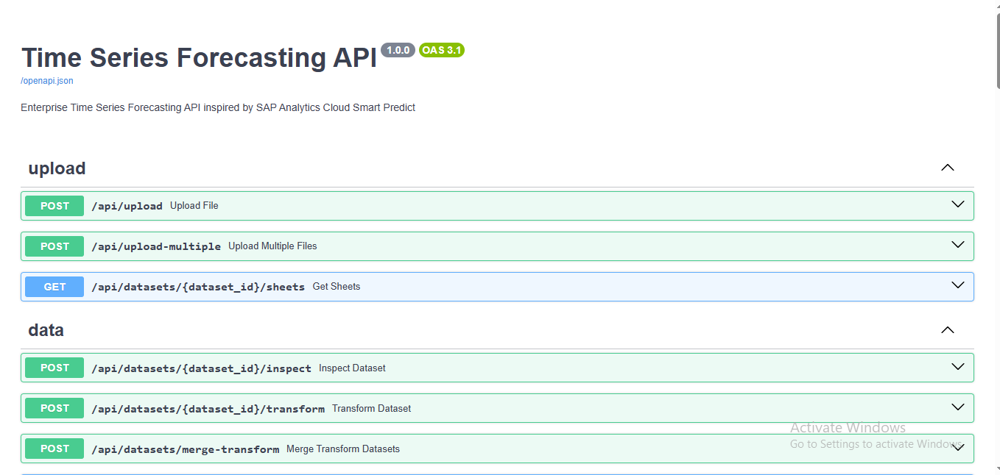
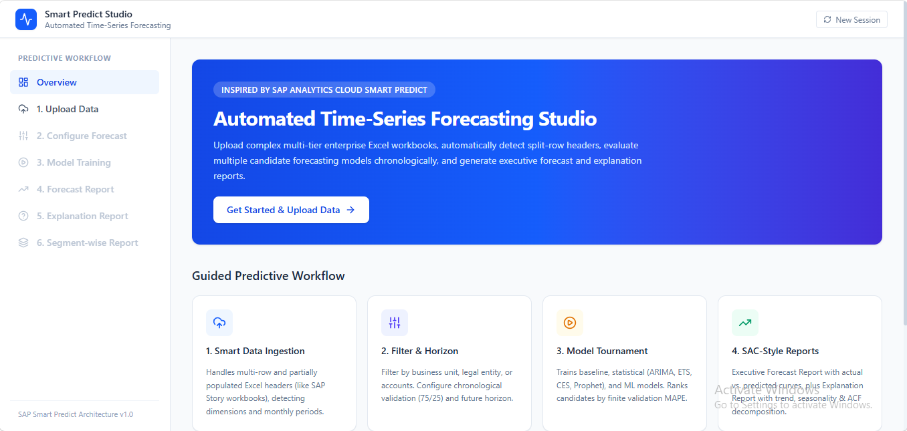
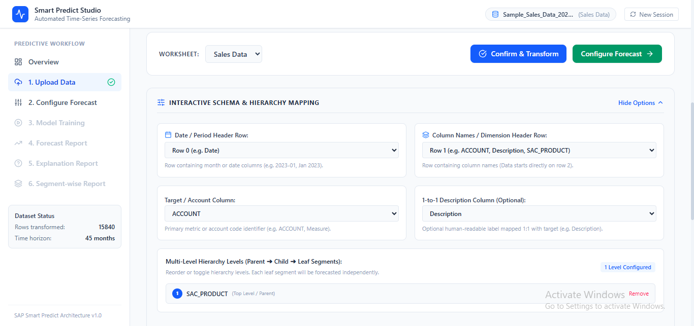
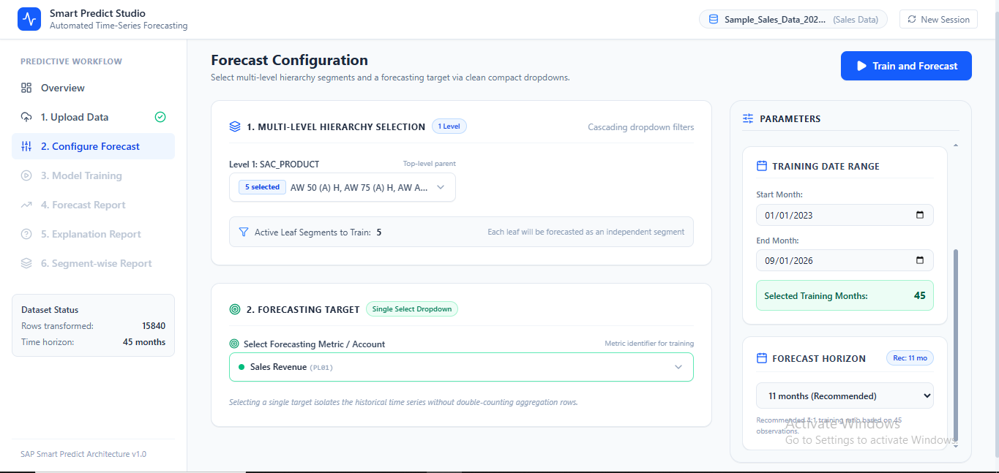
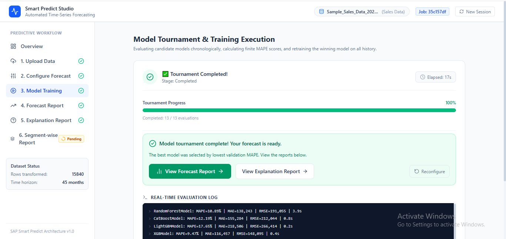
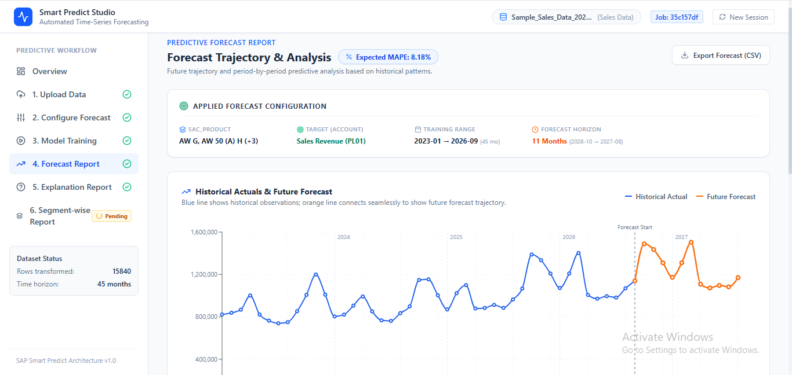
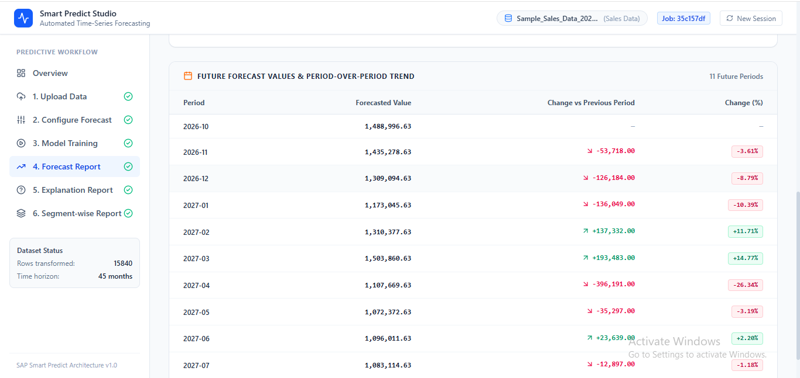
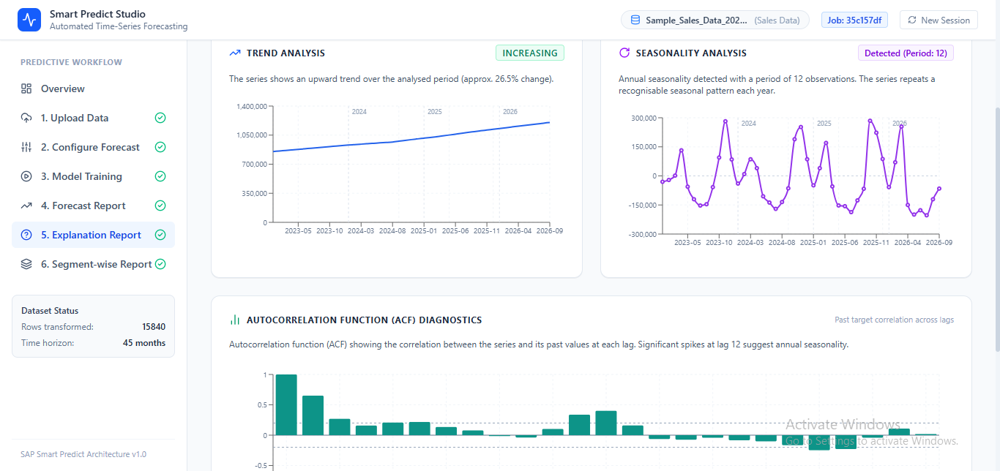
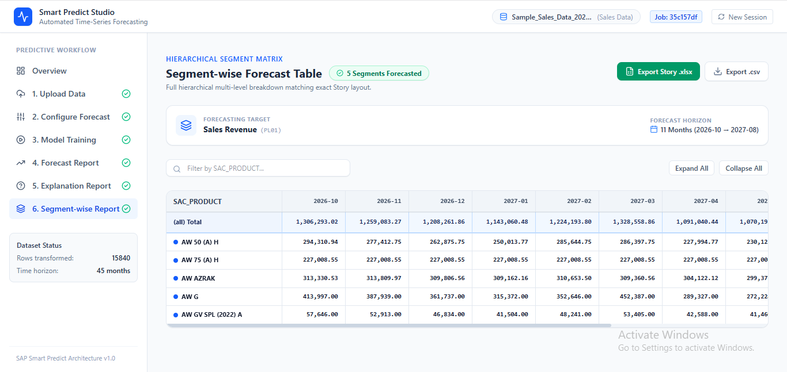

# Live Cloud Deployment Guide (Deployed Version)

This guide explains how to access and use the live, cloud-hosted version of **Smart Predict Studio** on Render without installing anything on your local machine.

---

## 🌐 Live Application Links

- **Backend API (Swagger Docs)**: [https://timeseries-backend-qoem.onrender.com/docs](https://timeseries-backend-qoem.onrender.com/docs)
- **Frontend Web Application**: [https://timeseries-frontend.onrender.com](https://timeseries-frontend.onrender.com)

---

## ⚠️ Important: Cloud Cold Start Procedure

Because the application is hosted on Render's free tier, the servers automatically enter sleep mode after 15 minutes of inactivity. 

**Always follow this 2-step procedure to avoid network timeouts:**

### Step 1: Open and Wake Up the Backend First
1. Click and open the Backend Swagger link in your browser:
   👉 **[https://timeseries-backend-qoem.onrender.com/docs](https://timeseries-backend-qoem.onrender.com/docs)**
2. Wait approximately **30 to 50 seconds** for the Render instance to boot up.
3. You will know the backend is awake when the **FastAPI Interactive Swagger UI** page loads successfully:

---

### Step 2: Open the Frontend Application
Once the Swagger page above is visible and active:
1. Open the Frontend Application:
   👉 **[https://timeseries-frontend.onrender.com](https://timeseries-frontend.onrender.com)**
2. The frontend is now connected to an active backend and will communicate instantly without API timeouts or network errors.

---

## 🚀 End-to-End Forecasting Workflow (On Cloud)

Follow this step-by-step workflow in the web application:

### Step 1: Upload Data & Layout Inspection (`/upload`)
- Navigate to the **Upload Data** tab.
- Click **Download Sample Excel** in the top action bar to download the pre-formatted reference workbook (`sample_timeseries_structure.xlsx`).
- Drag & drop a single Excel file or switch to **Multi-File Stitching** to stitch multiple annual files (e.g. 2023, 2024, 2025).
- The system automatically detects multi-row headers (Row 1: Periods, Row 2: Dimensions).

---

### Step 2: Confirm Schema & Transform Data
- Review the detected timeline start/end dates and discovered dimension columns (`Business Unit`, `SAC_Legal_Entity`, `SAC_PRODUCT`, `ACCOUNT`, `Description`).
- Adjust target account mapping if needed.
- Click **Confirm & Transform** to pivot the wide matrix into a normalized long format.
- After Transformation is complete, Click on **Configure Forecast**

---

### Step 3: Forecast Configuration (`/configure`)
- **Multi-Level Hierarchy Selection (Left Panel)**: Select Business Units, Legal Entities, and Product categories. Unique scoped values (e.g. `"BU1-1400"`) prevent naming collisions between different BUs, and selected items stay pinned at the top.
- **Forecasting Target**: Select your target financial or operational metric (e.g., `Sales Revenue (PL01)`).
- **Parameters & Telemetry (Right Panel)**: The right panel has an independent scrollbar while the left panel stays locked in place. Review observation counts, select your custom training date range, and adjust the forecast horizon (defaults to the recommended 4:1 training ratio).
- Click **Train and Forecast**.

---

### Step 4: Real-Time Model Training Tournament (`/training`)
- Watch candidate models compete side-by-side in real time across statistical (`ARIMA`, `AutoETS`, `Prophet`, etc.), machine learning (`CatBoost`, `LightGBM`, `RandomForest`, `LinearRegression`, `XGBoost`), and baseline families.
- Live progress shows real-time percentage completion, active model fitting, duration in seconds, and execution log tail.
- Once tournament evaluation completes, the winning model (lowest finite validation MAPE) is crowned champion and automatically refitted on 100% of historical observations.

---

### Step 5: Interactive Forecast Report (`/report/forecast`)
- **Historical vs. Forecast Chart**: Seamlessly visualizes actual historical observations alongside the orange future forecast trajectory.
- **Validation Accuracy**: Evaluates out-of-sample backtest performance (Actual vs. Predicted, MAPE, MAE, RMSE).
- **Forecast Table**: Displays period-over-period forecasted figures with export options to CSV or Excel.

---

### Step 6: Statistical Explanation Report (`/report/explanation`)
- **Trend Trajectory**: Extracts linear slope direction and overall historical momentum.
- **Seasonality Pattern**: Identifies recurring annual 12-month seasonal peaks and valleys.
- **Autocorrelation (ACF) Diagnostics**: Plots ACF lag correlation bars to detect repeating cyclic behavior.

---

### Step 7: Hierarchical Segment-Wise Report (`/report/segment-wise`)
- Displays an independent forecast table broken down across every selected leaf segment.
- Formatted as a multi-level hierarchical matrix mirroring the SAP Analytics Cloud Story export layout.
- Provides immediate warnings for sparse segments with insufficient data (< 4 points).
- Click **Export Story .xlsx** to download the complete hierarchical forecast matrix directly to Excel.

---

### Step 8: Starting a Fresh Session
- When you are ready to forecast a new dataset, click **New Session** in the top navigation bar or simply upload new files on the Upload page.
- All previous tournament jobs, segment predictions, and parameters are automatically reset.

---

## 💡 Cloud Instance Notes
- **Memory Optimization**: The deployed backend incorporates low-memory streaming readers, chunked previewing, category datatype compression, and garbage collection sweeps (`gc.collect()`) to run reliably within Render's 512MB RAM free tier limit.

