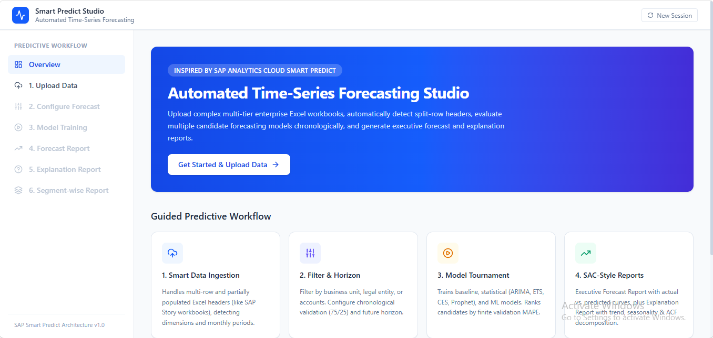
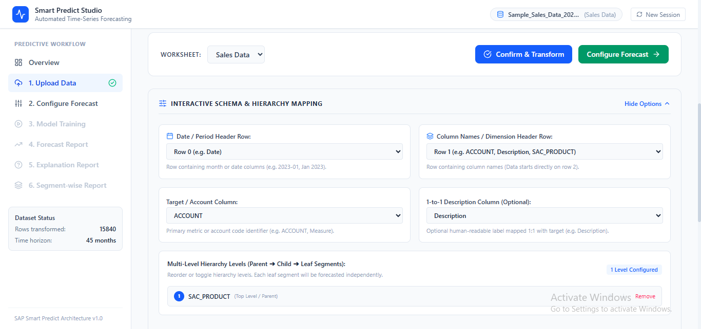
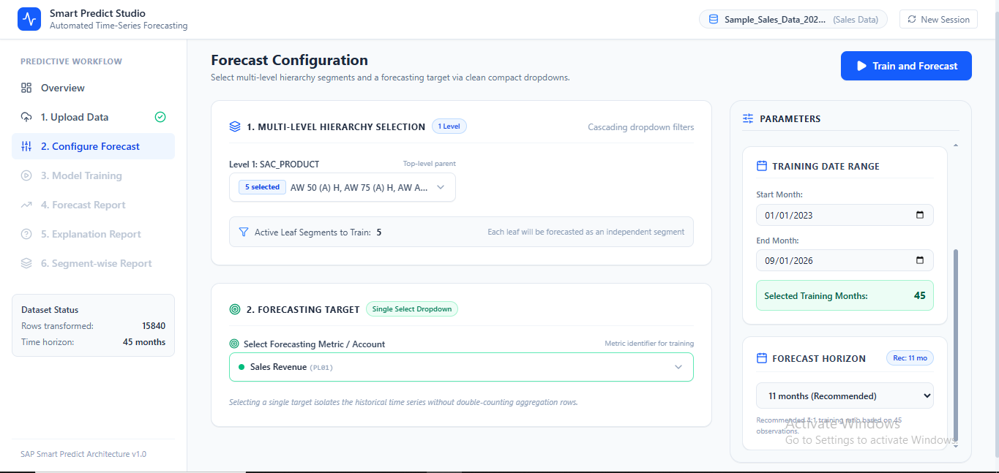
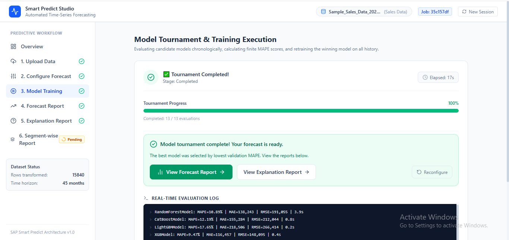
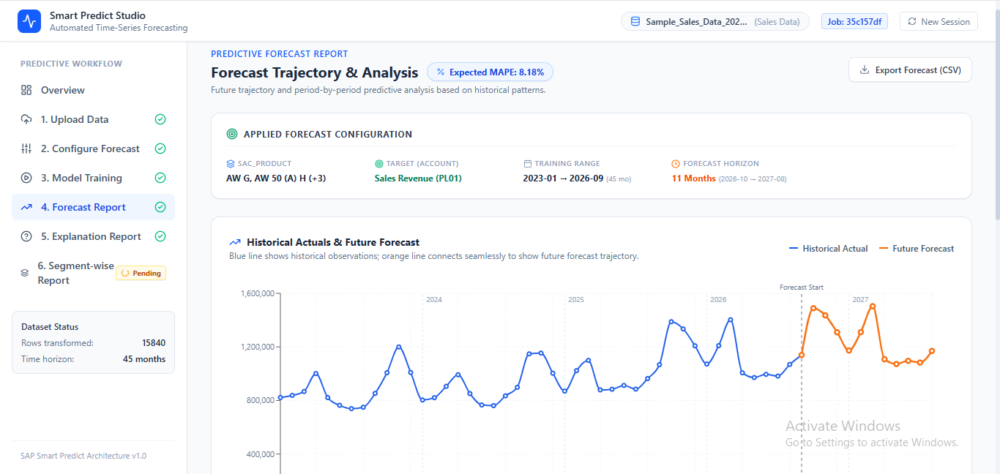
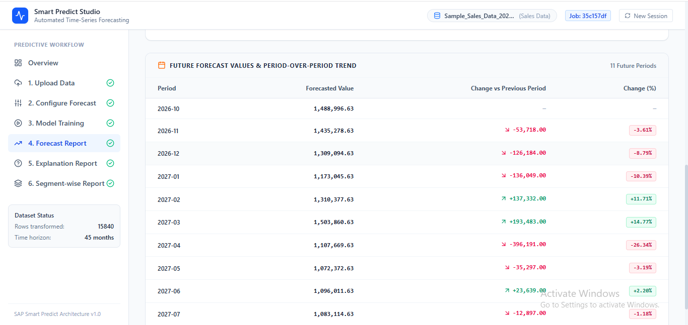
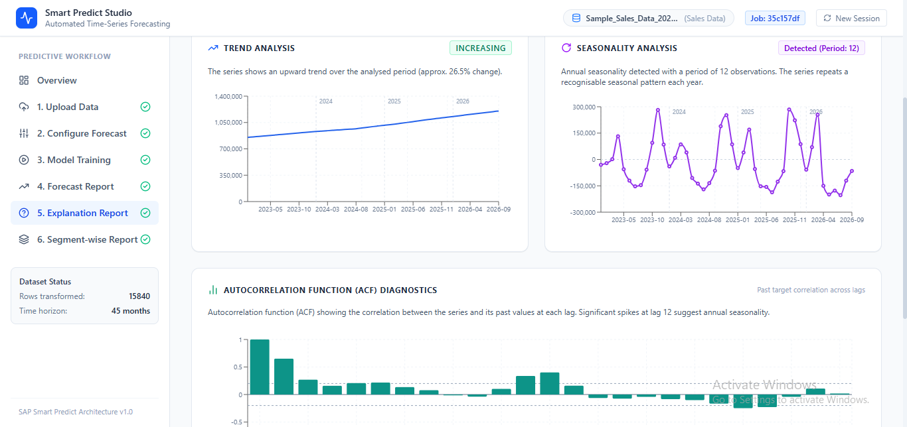
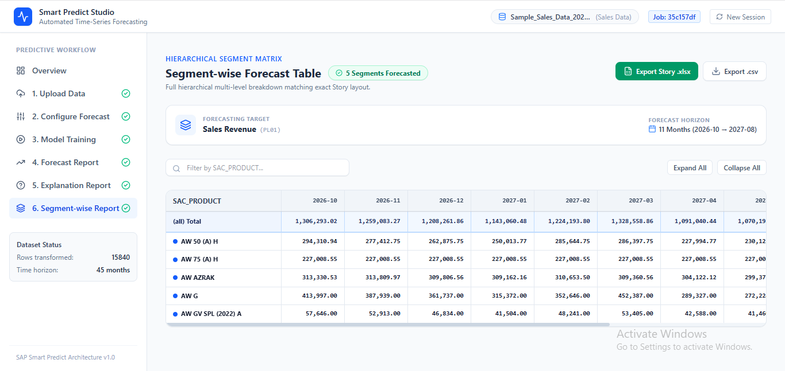

# Local Development & Setup Guide (Run on Local Machine)

This guide provides step-by-step instructions to clone, install dependencies, and run both the **Backend (FastAPI)** and **Frontend (React + Vite)** locally on your development machine.

---

## Prerequisites

Before starting, ensure you have the following installed on your machine:

1. **Git**: [Download Git](https://git-scm.com/downloads)
2. **Python 3.12** (Python 3.12.x recommended; Python 3.13 is also supported):
   - Check version:
     ```bash
     python --version
     ```
3. **Node.js (v18.x or v20.x+) & npm**:
   - Check version:
     ```bash
     node -v
     npm -v
     ```
4. **`uv` (Recommended Python package manager)**:
   - Extremely fast installer and runner for Python virtual environments.
   - Install via `pip`:
     ```bash
     pip install uv
     ```
   - Or install via official standalone installers:
     - **Windows (PowerShell)**:
       ```powershell
       powershell -ExecutionPolicy ByPass -c "irm https://astral.sh/uv/install.ps1 | iex"
       ```
     - **macOS / Linux (curl)**:
       ```bash
       curl -LsSf https://astral.sh/uv/install.sh | sh
       ```

---

## Step 1: Clone the Repository

Open your terminal or PowerShell and run:

```bash
git clone https://github.com/MRushan-Trijotech/Time-Series-System-Python-Darts-FastAPI-React.git
cd Time-Series-System-Python-Darts-FastAPI-React
```

Verify you are in the project root containing `Backend/` and `Frontend/`:

```text
Time-Series-System-Python-Darts-FastAPI-React/
├── Backend/
├── Frontend/
├── Images/
├── README.md
├── Instruction_Deployed.md
└── Instruction_Local.md
```

---

## Step 2: Backend Setup & Installation

You will need two separate terminal windows: one for the Backend and one for the Frontend.

### Method A: Using `uv` (Recommended & Fastest)

1. Open your first terminal and navigate to `Backend`:
   ```bash
   cd Backend
   ```

2. Create a virtual environment using `uv`:
   ```bash
   uv venv .venv
   ```

3. Activate the virtual environment:
   - **Windows (PowerShell)**:
     ```powershell
     .venv\Scripts\activate
     ```
   - **Windows (Command Prompt)**:
     ```cmd
     .venv\Scripts\activate.bat
     ```
   - **macOS / Linux**:
     ```bash
     source .venv/bin/activate
     ```

4. Install and synchronize all dependencies:
   ```bash
   uv sync
   ```
   *This installs all project dependencies (FastAPI, Darts, Pandas, Scikit-learn, LightGBM, CatBoost, Statsmodels, Uvicorn, etc.) directly into `.venv/`.*

---

### Method B: Using Standard Python `venv` and `pip`

If you prefer not to use `uv`, you can use standard Python tooling:

1. Open your terminal and navigate to `Backend`:
   ```bash
   cd Backend
   ```

2. Create and activate a virtual environment:
   - **Windows**:
     ```powershell
     python -m venv .venv
     .venv\Scripts\activate
     ```
   - **macOS / Linux**:
     ```bash
     python3 -m venv .venv
     source .venv/bin/activate
     ```

3. Upgrade `pip` and install dependencies:
   ```bash
   pip install --upgrade pip
   pip install -e .
   pip install pytest pytest-asyncio httpx
   ```

---

## Step 3: Run the Backend Server (Uvicorn)

From inside the `Backend` directory:

### If using `uv`:
```bash
uv run uvicorn backend.main:app --reload --port 8000
```

### If virtual environment is activated:
```bash
uvicorn backend.main:app --reload --port 8000
```

You should see output confirming Uvicorn has started:
```text
INFO:     Uvicorn running on http://127.0.0.1:8000 (Press CTRL+C to quit)
INFO:     Started reloader process [...] using StatReload
INFO:     Waiting for application startup.
INFO:     Application startup complete.
```

Leave this terminal running.

---

## Step 4: Frontend Setup & Installation

Open a **second terminal window** and navigate to the `Frontend` directory:

```bash
cd Frontend
```

Install the Node.js packages using `npm`:

```bash
npm install
```

---

## Step 5: Run the Frontend Application

From inside the `Frontend` directory, start the Vite development server:

```bash
npm run dev
```

You will see:
```text
  VITE v8.3.5  ready in 250 ms

  ➜  Local:   http://localhost:5173/
  ➜  Network: use --host to expose
  ➜  press h + enter to show help
```

---

## Step 6: Verify the Setup in Your Browser

Open your browser and test the running services:

1. **Frontend Web UI**: [http://localhost:5173](http://localhost:5173)
2. **Backend Swagger API Docs**: [http://localhost:8000/docs](http://localhost:8000/docs)
3. **Backend Health Check**: [http://localhost:8000/api/health](http://localhost:8000/api/health) *(returns `{"status": "healthy"}`)*

---

## Step 7: Running Test Suites & Verification

### Run Backend Tests (Pytest)
In the Backend terminal:
```bash
# With uv:
uv run pytest tests/ -v

# Or with activated .venv:
pytest tests/ -v
```
Expected result: All 9 unit and integration tests passing (`100%`).

### Verify Frontend Production Build
In the Frontend terminal:
```bash
npm run build
```
Expected result: Clean TypeScript compilation and Vite bundle with 0 errors.

---

## Step 8: End-to-End Workflow Walkthrough

Follow these steps to run an end-to-end forecasting pipeline locally:

### Step 8.1: Upload Data & Layout Inspection (`/upload`)
- Open [http://localhost:5173/upload](http://localhost:5173/upload).
- Click **Download Sample Excel** in the top action bar to download the reference workbook (`sample_timeseries_structure.xlsx`).
- Upload a single workbook or choose **Multi-File Stitching** to stitch multiple annual files (e.g. 2023, 2024, 2025).
- The system automatically detects multi-row headers (Row 1: Periods, Row 2: Dimensions).



---

### Step 8.2: Confirm Schema & Transform Data
- Review the detected period timeline and dimension columns (`Business Unit`, `SAC_Legal_Entity`, `SAC_PRODUCT`, `ACCOUNT`, `Description`).
- Adjust target account mapping if desired.
- Click **Confirm & Transform** to pivot the wide matrix into a normalized long format.



---

### Step 8.3: Forecast Configuration (`/configure`)
- **Multi-Level Hierarchy Selection (Left Panel)**: Select Business Units, Legal Entities, and Products. Scoped values (e.g. `"BU1-1400"`) prevent cross-BU selection collisions, and selected items stay pinned at the top.
- **Forecasting Target**: Select your target metric (e.g., `Sales Revenue (PL01)`).
- **Parameters & Telemetry (Right Panel)**: The right panel has an independent scrollbar while the left panel stays locked in place. Review observation counts, select your custom training date range, and adjust the forecast horizon (defaults to the recommended 4:1 training ratio).
- Click **Train and Forecast**.



---

### Step 8.4: Real-Time Model Training Tournament (`/training`)
- Candidate models compete across statistical (`ARIMA`, `AutoETS`, `Prophet`, etc.), machine learning (`CatBoost`, `LightGBM`, `RandomForest`, `LinearRegression`, `XGBoost`), and baseline families.
- Live progress displays real-time percent completion, active model fitting, duration in seconds, and execution log tail.
- The model with the lowest validation MAPE is selected as Champion and refitted on 100% of historical data.



---

### Step 8.5: Interactive Forecast Report (`/report/forecast`)
- **Historical vs. Forecast Chart**: Visualizes historical observations alongside the orange forecast trajectory.
- **Validation Accuracy**: Out-of-sample backtest scores (Actual vs. Predicted, MAPE, MAE, RMSE).
- **Forecast Table**: Period-over-period forecasted figures with export options to CSV or Excel.





---

### Step 8.6: Statistical Explanation Report (`/report/explanation`)
- **Trend Trajectory**: Linear slope direction and overall historical momentum.
- **Seasonality Pattern**: Annual 12-month recurring seasonal peaks and valleys.
- **Autocorrelation (ACF) Diagnostics**: Autocorrelation lag correlation bars.



---

### Step 8.7: Hierarchical Segment-Wise Report (`/report/segment-wise`)
- Displays an independent forecast table broken down across every selected leaf segment.
- Formatted as a multi-level hierarchical matrix mirroring the SAP Analytics Cloud Story export layout.
- Provides immediate warnings for sparse segments (< 4 points).
- Click **Export Story .xlsx** to download the complete matrix directly to Excel.



---

### Step 8.8: Starting a Fresh Session
- Click **New Session** in the top navigation bar or upload new files on the Upload page.
- All previous tournament jobs, segment predictions, and parameters are cleanly reset.

---

## Common Troubleshooting & FAQs

### 1. `uvicorn: command not found`
- **Cause**: Virtual environment is not activated or dependencies were not installed.
- **Fix**: Run `uv sync` inside `Backend` and use `uv run uvicorn backend.main:app --reload --port 8000`, or activate `.venv` first (`.venv\Scripts\activate` on Windows).

### 2. `Network Error` or CORS issues when clicking Transform
- **Cause**: Backend server is not running on port 8000.
- **Fix**: Verify backend terminal is running and shows `Uvicorn running on http://127.0.0.1:8000`. Test `http://localhost:8000/api/health` in your browser.

### 3. Port 8000 or 5173 Already in Use
- **Windows**:
  ```powershell
  # Find PID using port 8000:
  netstat -ano | findstr :8000
  # Terminate PID:
  taskkill /PID <PID> /F
  ```
- **macOS / Linux**:
  ```bash
  lsof -i :8000
  kill -9 <PID>
  ```

### 4. PowerShell Execution Policy Restriction on Windows
- **Error**: `File ... activate.ps1 cannot be loaded because running scripts is disabled on this system.`
- **Fix**: Open PowerShell as Administrator and run:
  ```powershell
  Set-ExecutionPolicy -ExecutionPolicy RemoteSigned -Scope CurrentUser
  ```

