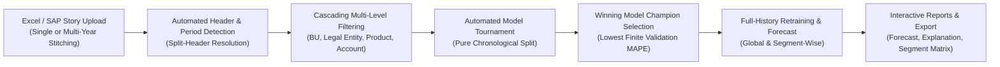
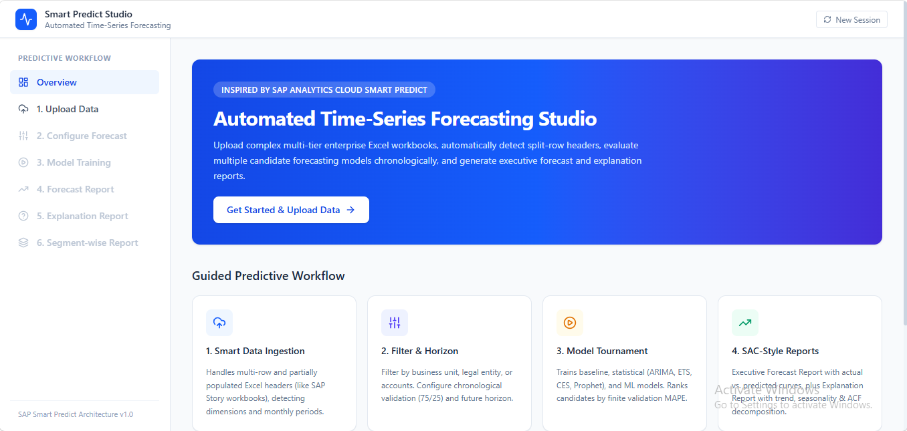
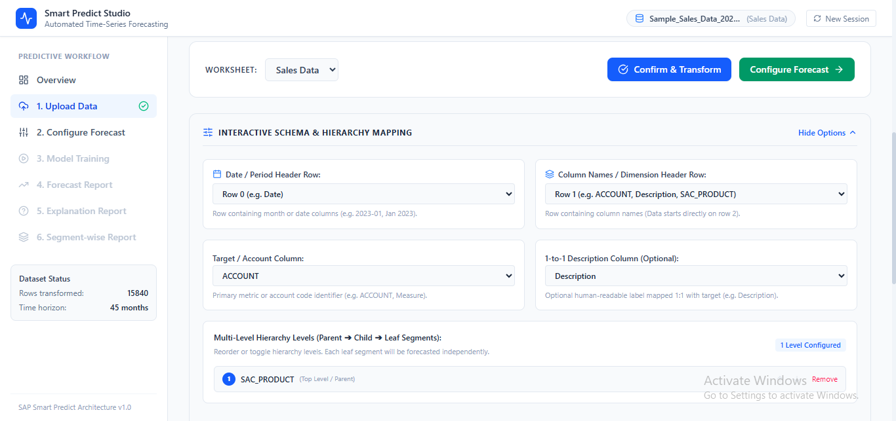
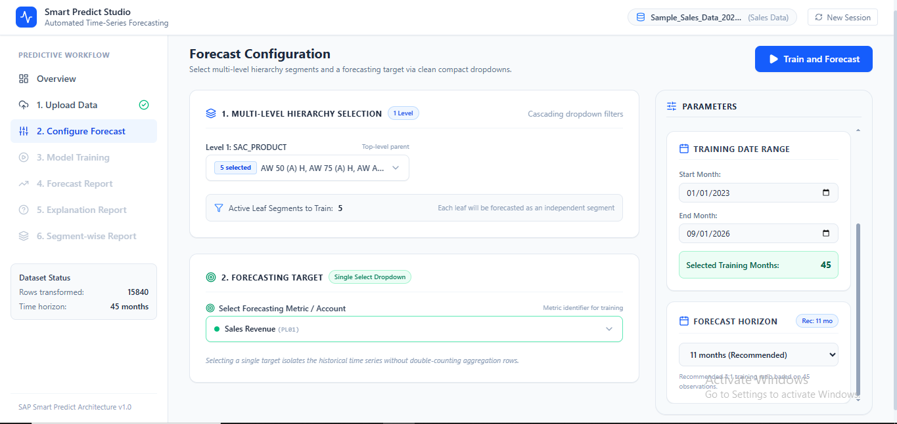
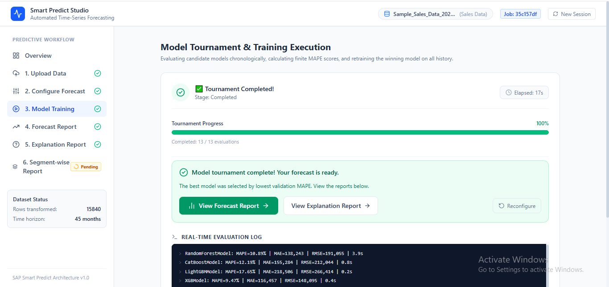
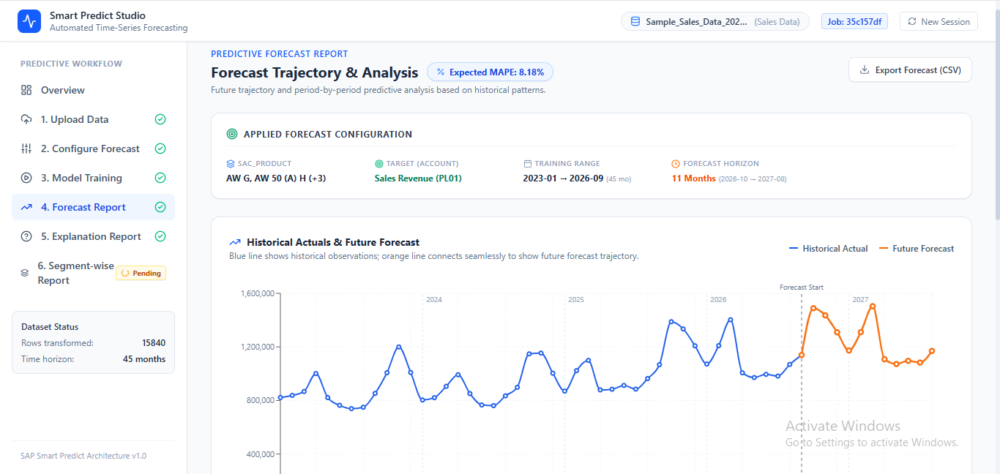
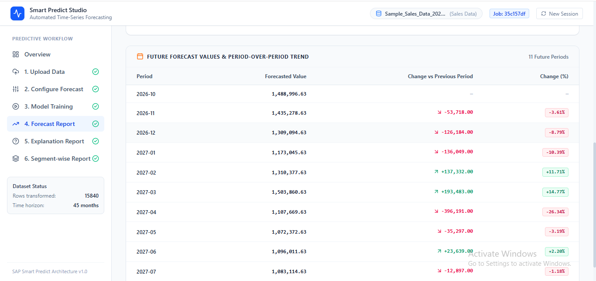
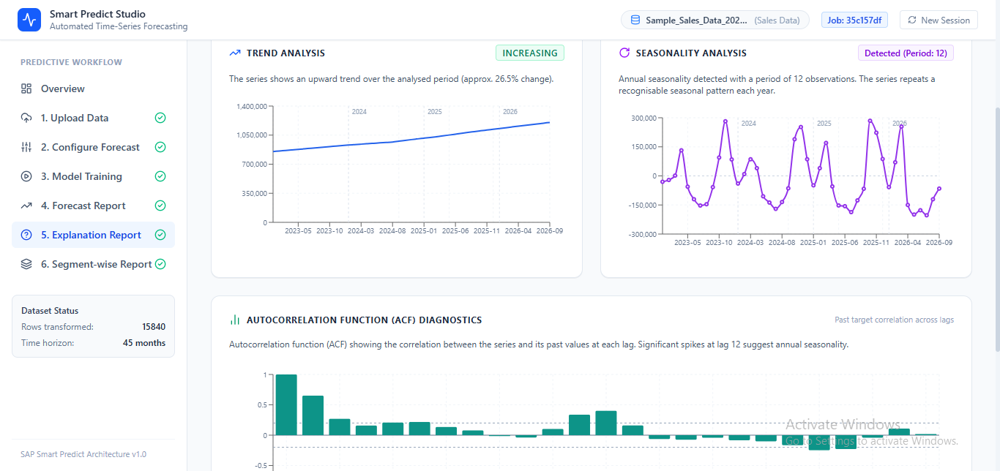
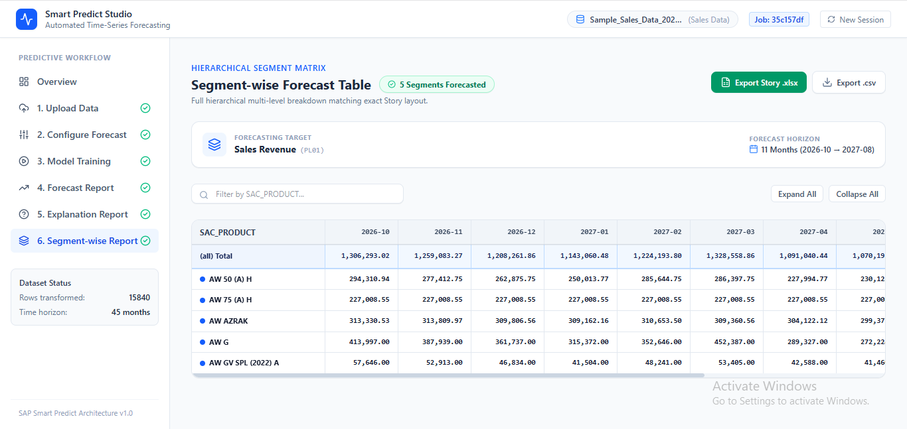

# Smart Predict Studio – Enterprise Time-Series Forecasting Platform

[](https://www.python.org/)
[](https://fastapi.tiangolo.com/)
[](https://react.dev/)
[](https://www.typescriptlang.org/)
[](https://tailwindcss.com/)
[](https://unit8co.github.io/darts/)

**Smart Predict Studio** is an enterprise-grade time-series forecasting web application inspired by **SAP Analytics Cloud Smart Predict**. It empowers finance, sales, and supply chain analysts to upload complex hierarchical datasets (such as multi-row SAP Analytics Cloud Story workbooks), automatically detect multi-year timeline columns, run automated candidate model tournaments, and generate granular forecasts at both the global and leaf-segment levels.

---

## Key Capabilities



### 1. Intelligent Split-Header & Period Detection
- Automatically parses multi-row Excel headers where time periods (years, quarters, months) are spread across columns on Row 1, and business dimensions (`Business Unit`, `SAC_Legal_Entity`, `SAC_PRODUCT`, `ACCOUNT`, `Description`) are located on Row 2.
- Intelligently skips aggregate summary columns (Year totals, Quarter totals) to preserve pure, monthly-frequency observations.
- Interactive schema mapping editor allows custom fine-tuning of header depth and dimension roles.

### 2. Multi-File Stitching & Compatibility Verification
- Stitch multi-year datasets across separate files (e.g. 2023, 2024, 2025, 2026).
- Verifies structural compatibility, dimension alignment, and continuous timeline connectivity before merging.
- Low-memory streaming and chunking ensures reliability on cloud instances with constrained memory (512MB RAM).

### 3. Collision-Free Cascading Hierarchy Selection
- Dynamically discovers all hierarchy levels and builds nested parent-child trees.
- Scoped multi-select filters (`"BU1-1400"`, `"BU2-1400"`) eliminate cross-business-unit naming collisions.
- Pinned selected items at the top of multi-select dropdowns for effortless navigation across hundreds of segments.

### 4. Automated Candidate Model Tournament
- Chronological backtesting split (e.g. 75% Train / 25% Validation) without observation shuffling or lookahead leakage.
- Evaluates diverse model families via **Unit8 Darts**:
  - **Statistical**: `AutoARIMA`, `ARIMA`, `AutoETS`, `ExponentialSmoothing`, `AutoCES`, `Prophet`
  - **Machine Learning**: `CatBoostModel`, `LightGBMModel`, `RandomForestModel`, `LinearRegressionModel`, `XGBModel`
  - **Baseline**: `NaiveSeasonal`
- Real-time tournament progression tracking with live per-model logs, duration counters, and execution status.

### 5. Retraining on 100% History
- Once the champion model is selected based on lowest validation MAPE, a fresh instance is retrained on all available historical data (100% of observations) to project into the future horizon.

### 6. Comprehensive Reporting & Segment Matrix
- **Forecast Report**: Interactive Recharts visualization with historical actuals, continuous future projection, validation actual vs. predicted curves, residual error analysis, and period-over-period trend tables.
- **Explanation Report**: Statistical diagnostics including linear trend slope, annual seasonality decomposition (12-month periodicity), and Autocorrelation Function (ACF) lag analysis.
- **Segment-Wise Matrix**: Hierarchical multi-level breakdown matching exact SAP Analytics Cloud Story layouts, collapsible parent-child rows, sparse segment warnings, and direct Excel (`.xlsx`) / CSV export.
- **Sample Structure Generator**: Built-in template generator (`sample_timeseries_structure.xlsx`) downloadable directly from the upload screen.

---

## Application Walkthrough & Screenshots

| 1. Data Upload & Split-Header Detection | 2. Schema Confirmation & Transformation |
|:---:|:---:|
|  |  |

| 3. Forecast Configuration & Independent Scroll | 4. Model Training Tournament |
|:---:|:---:|
|  |  |

| 5. Forecast Report & Trajectory Chart | 6. Forecast Values & Period Trend Table |
|:---:|:---:|
|  |  |

| 7. Statistical Explanation (Trend, Seasonality, ACF) | 8. Hierarchical Segment-Wise Matrix |
|:---:|:---:|
|  |  |

---

## Project Structure

```text
Time_Series_App/
├── README.md                      # Project overview & documentation
├── Instruction.md                 # Complete setup, installation, and run guide
├── Backend/                       # Python FastAPI application
│   ├── pyproject.toml             # Dependencies & package configuration
│   ├── src/
│   │   └── backend/
│   │       ├── main.py            # FastAPI entry point & router mounting
│   │       ├── config.py          # Application settings & environment variables
│   │       ├── api/               # API route controllers
│   │       │   ├── routes_upload.py    # File upload, multi-file stitching
│   │       │   ├── routes_data.py      # Header inspection, transform, sample template
│   │       │   ├── routes_training.py  # Tournament job dispatch & polling
│   │       │   └── routes_reports.py   # Forecast, explanation, & export endpoints
│   │       ├── jobs/              # Background job execution & training manager
│   │       ├── services/          # Core forecasting & data processing logic
│   │       │   ├── header_detection.py # Multi-row header detection engine
│   │       │   ├── data_transformer.py # Wide-to-long melt & aggregation
│   │       │   ├── model_registry.py   # Darts model definitions & tournament ranking
│   │       │   └── dataset_store.py    # In-memory & disk dataset storage
│   │       └── schemas/           # Pydantic validation models
│   └── tests/                     # Pytest suite
└── Frontend/                      # React 19 + TypeScript + Vite application
    ├── package.json               # Node.js dependencies & scripts
    ├── vite.config.ts             # Vite configuration with proxy to port 8000
    ├── src/
    │   ├── main.tsx               # React root entry
    │   ├── App.tsx                # App routing & session wrapper
    │   ├── api/                   # Axios client for backend communication
    │   ├── contexts/              # Global session context & workflow state
    │   ├── components/            # Reusable UI & layout components
    │   │   └── layout/            # Navbar, Sidebar, AppLayout
    │   └── pages/                 # Application workflow pages
    │       ├── UploadPage.tsx          # Upload, multi-file stitch & template download
    │       ├── ConfigurationPage.tsx   # Cascading hierarchy & target account selection
    │       ├── TrainingPage.tsx        # Live model tournament execution
    │       ├── ForecastReportPage.tsx  # Forecast trajectories & accuracy KPIs
    │       ├── ExplanationReportPage.tsx # Trend, seasonality, & ACF lag diagnostics
    │       ├── SegmentWiseReportPage.tsx # Multi-level hierarchical breakdown table
    │       └── DashboardPage.tsx       # System overview & architectural workflow
```

---

## Quick Start Summary

Repository: [https://github.com/MRushan-Trijotech/Time-Series-System-Python-Darts-FastAPI-React.git](https://github.com/MRushan-Trijotech/Time-Series-System-Python-Darts-FastAPI-React.git)

For the step-by-step setup guide from repository cloning to running servers, see **[Instruction.md](file:///e:/Mohd_Rushan/Time%20Series/Time_Series_App/Instruction.md)**.

### Quick Commands

```bash
# Clone the repository
git clone https://github.com/MRushan-Trijotech/Time-Series-System-Python-Darts-FastAPI-React.git
cd Time-Series-System-Python-Darts-FastAPI-React

# Terminal 1: Backend
cd Backend
uv venv .venv
uv sync
uv run uvicorn backend.main:app --reload --port 8000

# Terminal 2: Frontend
cd Frontend
npm install
npm run dev
```

Open your browser to:
- **Frontend App**: `http://localhost:5173`
- **Backend Swagger API Docs**: `http://localhost:8000/docs`
- **Backend Health Check**: `http://localhost:8000/api/health`

---

## API Summary

| Category | Method | Endpoint | Description |
|---|---|---|---|
| **Data Ingestion** | `POST` | `/api/upload` | Upload single Excel workbook and extract sheets |
| | `POST` | `/api/upload-multiple` | Upload multiple workbooks & check schema compatibility |
| | `POST` | `/api/datasets/merge-transform` | Stitch multiple files across time into a single dataset |
| | `GET` | `/api/data/sample-template` | Download pre-formatted sample structure Excel file |
| **Inspection & Transform** | `POST` | `/api/datasets/{id}/inspect` | Detect split headers, periods, and dimensions |
| | `POST` | `/api/datasets/{id}/transform` | Pivot workbook to clean long format |
| | `GET` | `/api/datasets/{id}/dimensions` | Retrieve discovered hierarchy levels and unique tree nodes |
| | `POST` | `/api/datasets/{id}/series-info` | Calculate active observation count and suggested horizon |
| **Model Tournament** | `GET` | `/api/training/models/available` | List supported candidate models and min observation rules |
| | `POST` | `/api/training` | Submit asynchronous training tournament job |
| | `GET` | `/api/training/{job_id}` | Poll tournament progress, stage, and log tail |
| **Reports & Exports** | `GET` | `/api/reports/{job_id}/forecast` | Retrieve forecast points, actuals, and validation scores |
| | `GET` | `/api/reports/{job_id}/explanation` | Retrieve trend slope, seasonality curve, and ACF values |
| | `GET` | `/api/reports/{job_id}/segment-wise` | Retrieve multi-level hierarchical segment predictions |
| | `GET` | `/api/reports/{job_id}/export/segment-wise.xlsx` | Export segment-wise matrix as formatted `.xlsx` |
| | `GET` | `/api/reports/{job_id}/export/forecast.csv` | Download forecast table as CSV |
| | `GET` | `/api/reports/{job_id}/export/models.csv` | Download model tournament leaderboard as CSV |

---

## License & Attribution

Developed by **Trijotech** for automated enterprise time-series forecasting. Built with open-source foundations from [FastAPI](https://fastapi.tiangolo.com/), [Unit8 Darts](https://unit8co.github.io/darts/), [React](https://react.dev/), and [Tailwind CSS](https://tailwindcss.com/).
